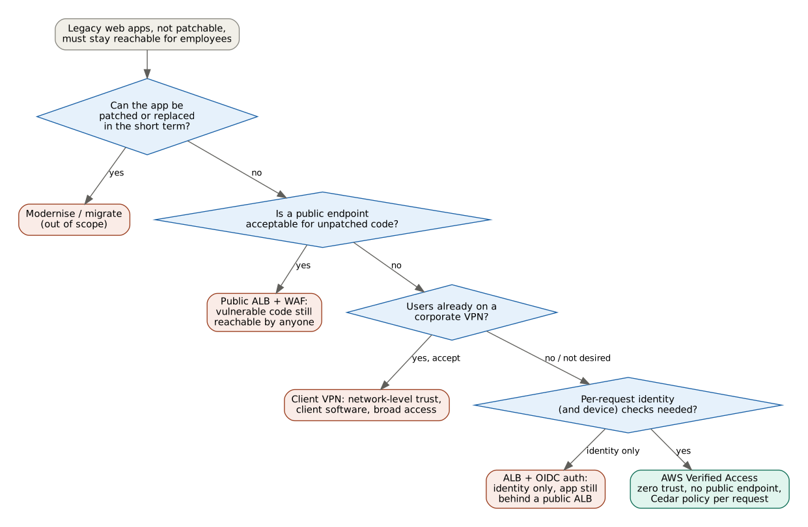
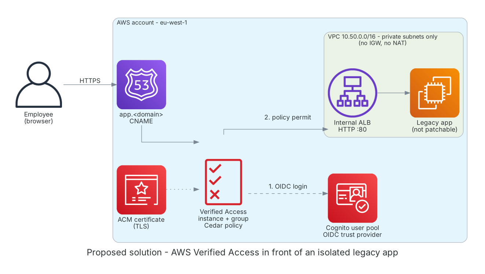
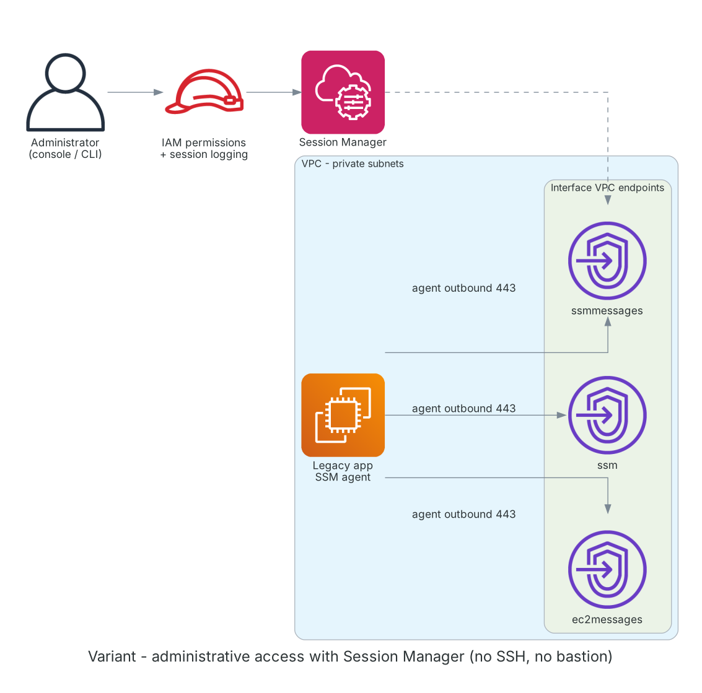

# Zero trust access to an isolated legacy application with AWS Verified Access

Proof of concept, built end to end in Terraform and tested in a disposable AWS account, then destroyed.
It is written as it would be delivered to a client: request, analysis, decision, proposed solution, variants, evidence and lessons learned.

## 1. The request

A set of internal web applications must stay available to employees, but they cannot be fixed:
deprecated PHP versions, outdated libraries, little or no documentation, and no team willing or able to upgrade them.
Exposing them to the internet is not acceptable, yet users need to reach them from anywhere without a complex client setup.

**Goal:** keep the applications usable while making sure that no unauthenticated or unauthorised request ever reaches the vulnerable code.

## 2. Constraints

- The application code and operating system cannot be changed or patched.
- No public IP, no public load balancer in front of the application.
- Access decided per user identity (and, in a later step, device posture), not per network location.
- Every access must be traceable for audit.
- Small team: managed services preferred over self-hosted gateways or VPN appliances.
- Everything defined as code, reproducible and destroyable.

## 3. Options considered



| Option | Security | User experience | Operations | Verdict |
|---|---|---|---|---|
| Patch or replace the application | Best | Unchanged | High effort, long timeline | Out of scope for now, tracked as technical debt |
| Public ALB + AWS WAF | Weak: unpatched code still reachable by anyone | Simple | Low | Rejected |
| AWS Client VPN | Network-level trust, broad lateral access once connected | Client software required | Certificates, client distribution | Rejected for this use case |
| Internet-facing ALB + OIDC authentication | Identity check only, ALB still public | Simple | Low | Viable fallback |
| **AWS Verified Access** | Per-request identity check, Cedar policy, no public app endpoint | Browser only, SSO login | Managed, policy as code | **Chosen** |

## 4. Proposed solution



1. The user opens `https://app.<domain>` in a browser. DNS points to the Verified Access endpoint, which presents the ACM certificate.
2. Without a session, Verified Access redirects the user to the identity provider (Amazon Cognito, OIDC). In production this would be the corporate IdP (Entra ID, Okta, IAM Identity Center).
3. After login, Verified Access evaluates the **Cedar policy** of the group on every request, using the claims of the identity provider.
4. Only permitted requests are forwarded to an **internal** Application Load Balancer, which reaches the application in private subnets.

The application has no public IP, the VPC has no Internet Gateway and no NAT gateway, and security groups are chained:
the application accepts traffic only from the ALB, the ALB only from inside the VPC.

Example policy used in the test (access limited to one named user):

```cedar
permit(principal, action, resource)
when {
  context has "cognito" &&
  context.cognito has "email" &&
  context.cognito.email == "user@example.com"
};
```

### Repository layout

| File | Content |
|---|---|
| `providers.tf` | Terraform and AWS provider versions, default tags for cost allocation |
| `network.tf` | VPC with two private subnets in two AZs, no internet route |
| `app.tf` | Security groups, IAM role for SSM, EC2 instance (IMDSv2 required) serving the test app |
| `alb.tf` | Internal ALB, target group with health check, HTTP listener |
| `acm.tf` | Public certificate with DNS validation in an existing Route 53 hosted zone |
| `cognito.tf` | User pool (admin-created users only), hosted login domain, OIDC app client |
| `va.tf` | Trust provider, Verified Access instance, group with Cedar policy, endpoint, DNS record |

## 5. Variant: administrative access with Session Manager

Verified Access protects **user access to the application**. Administrators still need **access to the server** for maintenance.
The recommended companion is AWS Systems Manager Session Manager: shell access through IAM, no SSH keys, no open inbound ports, no bastion host, every session logged.



In a fully isolated VPC the SSM agent cannot reach the service, so three interface VPC endpoints are required (`ssm`, `ssmmessages`, `ec2messages`).
The instance role for SSM is already part of this PoC; the endpoints were deliberately left out and documented here as the next step, since they add cost and the user-access flow was the focus of the test.

## 6. Tests performed

| # | Test | Expected | Result |
|---|---|---|---|
| 1 | Network isolation: route table and VPC resource map | Only `local` route, no IGW or NAT | Passed |
| 2 | App reachable from the ALB (target health) | `healthy` | Passed |
| 3 | Open `https://app.<domain>` without a session | Redirect to the IdP login page, app never reached | Passed |
| 4 | Login with a valid user allowed by the policy | Application page served over HTTPS | Passed |
| 5 | Policy tightened, same user logs in again | Authenticated but not authorised: `403 Unauthorized` | Passed |

Test 5 is the key one: a correct password is not enough. Authentication (who you are) and authorisation (what you may reach) are separate, and the decision is taken on every request.

## 7. Cost notes

- Verified Access is billed per application per hour plus data processed; it is by far the largest cost item of this design.
- Internal ALB and a small EC2 instance are a few cents per hour.
- Cognito, the ACM public certificate and the DNS records are free or negligible at this scale; the hosted zone has a small monthly fee and is kept outside the lifecycle of this stack.
- For many low-traffic applications, the per-application pricing should be compared with an internet-facing ALB + OIDC or a shared VPN before deciding.

## 8. Lessons learned

- **Endpoint lifecycle is slow:** creating the Verified Access endpoint took about 16 minutes, deleting it about 3. Any change that forces replacement (domain, certificate, subnets) means downtime: read the plan for `must be replaced`, schedule a change window, and give CI/CD pipelines long timeouts.
- **Policy changes are instant:** updating the Cedar policy was an in-place change applied in one second, with no impact on the endpoint.
- **Plan does not catch everything:** security group descriptions accept only a limited character set; an apostrophe passed `terraform plan` and failed only at apply.
- **Isolated means isolated:** without internet access the instance cannot install packages, so the test app uses only what ships with the AMI; management tools such as SSM need VPC endpoints.
- **Long-lived DNS outside the stack:** the hosted zone is read as a data source and delegated once from the registrar, so `destroy` / `apply` cycles never change the name servers.
- **Secrets in state:** the OIDC client secret is stored in plain text in the Terraform state. State must never be committed (see `.gitignore`); in a real project use an encrypted remote backend with restricted access.
- **Logging is mandatory in production:** Verified Access access logs (user, decision, request) were not enabled in this PoC but are required for audit.

## 9. How to run

Prerequisites: Terraform >= 1.10, AWS CLI with an SSO profile, a public Route 53 hosted zone for the chosen domain.

```bash
terraform init
terraform plan
terraform apply      # endpoint creation takes ~15 minutes
# create a test user in the Cognito user pool, then open https://app.<domain>
terraform destroy
```

Region `eu-west-1`. All resources carry the tags `Project`, `ManagedBy` and `Owner` for cost tracking.
